<div align="center">

# 🩺 BreastCare

**Breast Cancer Detection Web App**


[](https://breastcare-fawn.vercel.app)
[](https://breastcare-backend-skx9.onrender.com/actuator/health)

**[🌐 Open the live site](https://breastcare-fawn.vercel.app)** · [⚙️ Backend health](https://breastcare-backend-skx9.onrender.com/actuator/health) · [📘 Deployment guide](DEPLOYMENT.md)

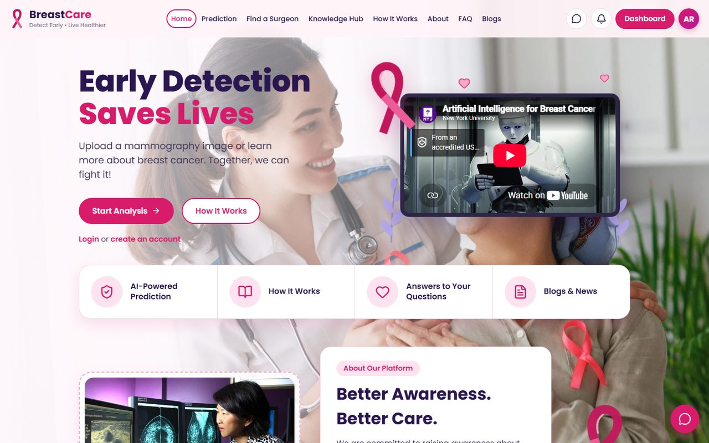

</div>

A patient signs in, uploads a mammogram and gets an estimated malignancy probability (**Benign** or **Malignant**)
with a heatmap. Results and images are stored in MongoDB Atlas and are visible only to the patient and the doctors
they choose to share them with.

> [!WARNING]
> For research and education only. This is not a medical device and does not replace a radiologist.

> [!NOTE]
> **Live demo status:** the live site runs on free hosting (Vercel + Render free plan). Accounts, the Knowledge Hub,
> the chatbot, doctors and appointments all work there. The AI models need about 3 GB of memory, more than the free
> plan has, so **mammogram analysis is switched off on the live server** for now. The screenshots below come from the
> same app running with the models on a local machine.

## 📑 Table of Contents

- [Why BreastCare?](#-why-breastcare)
- [Screenshots](#-screenshots)
- [How It Works](#-how-it-works)
- [Features](#-features)
- [Tech Stack](#-tech-stack)
- [Architecture](#-architecture)
- [Roles](#-roles)
- [The Model](#-the-model)
- [Project Structure](#-project-structure)
- [Getting Started](#-getting-started)
- [Security and Privacy](#-security-and-privacy)
- [Limitations](#-limitations)
- [Tests](#-tests)
- [Deployment](#-deployment)
- [Acknowledgements](#-acknowledgements)

## 💡 Why BreastCare?

Breast cancer is the most commonly diagnosed cancer in women worldwide, and it is far easier to treat when it is
found early. Mammography is the main screening test, but reading mammograms takes trained radiologists, and many
patients also lack clear, trustworthy information about what their results mean.

BreastCare is a university project that explores how software can support that process:

- **A second look:** an AI estimate on an uploaded mammogram, with a heatmap of the regions that influenced it, as
  decision support that a doctor reviews, never as a diagnosis.
- **Patient-controlled sharing:** the patient owns the report and decides which doctors can see it, and can ask a
  doctor for a written review.
- **Access to care:** patients can find verified breast surgeons and book appointments in the same place.
- **Awareness:** a Knowledge Hub that explains breast cancer in plain language, from self-examination to treatment.

## 📸 Screenshots

The mammograms below are from the **CBIS-DDSM** public test set (images the models never trained on).
The first was biopsy-proven **malignant**, the second **benign**, and the app classified both correctly.

| Upload and AI scan | Result: malignant case |
|---|---|
| 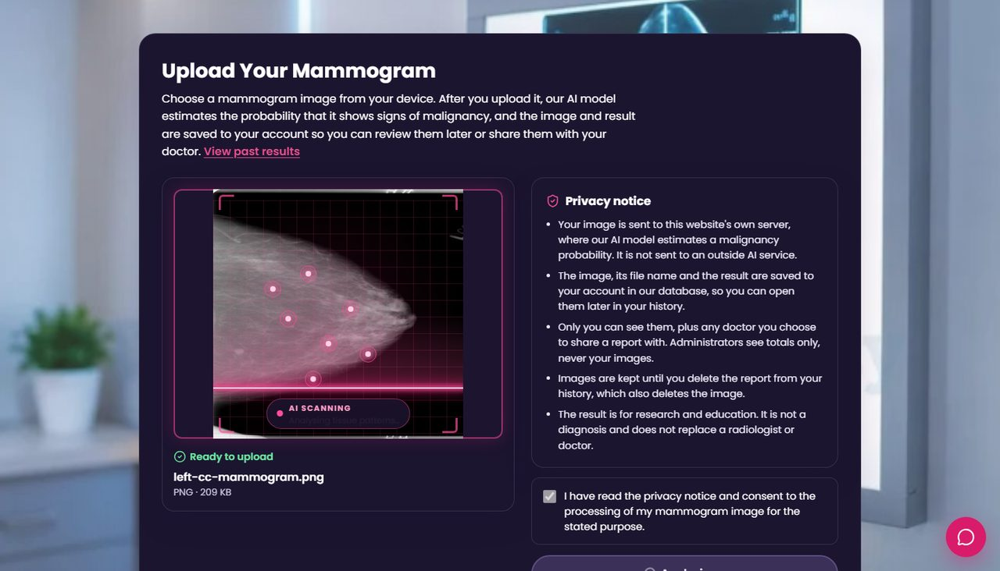 | 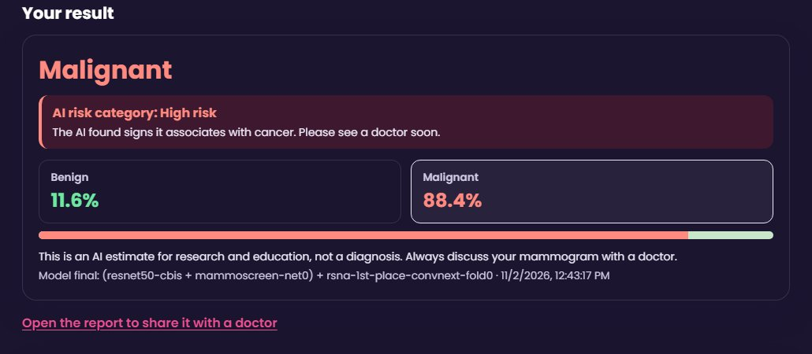 |
| **Result: benign case** | **Report with heatmap** |
| 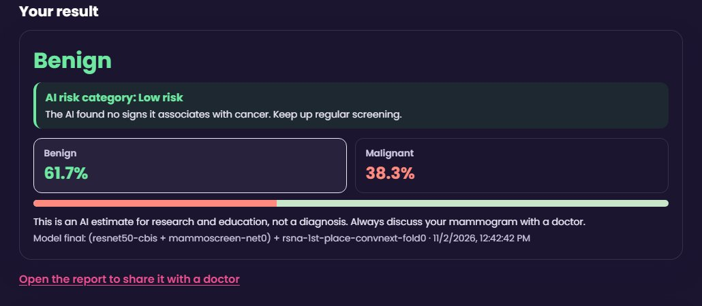 | 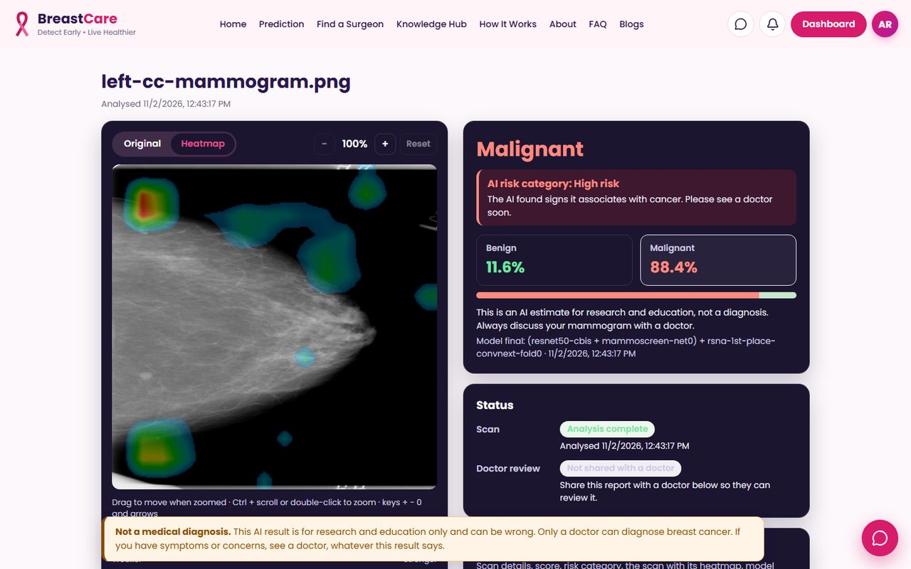 |
| **Prediction history** | **Patient dashboard** |
| 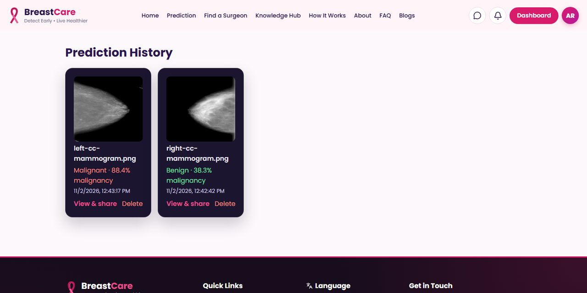 | 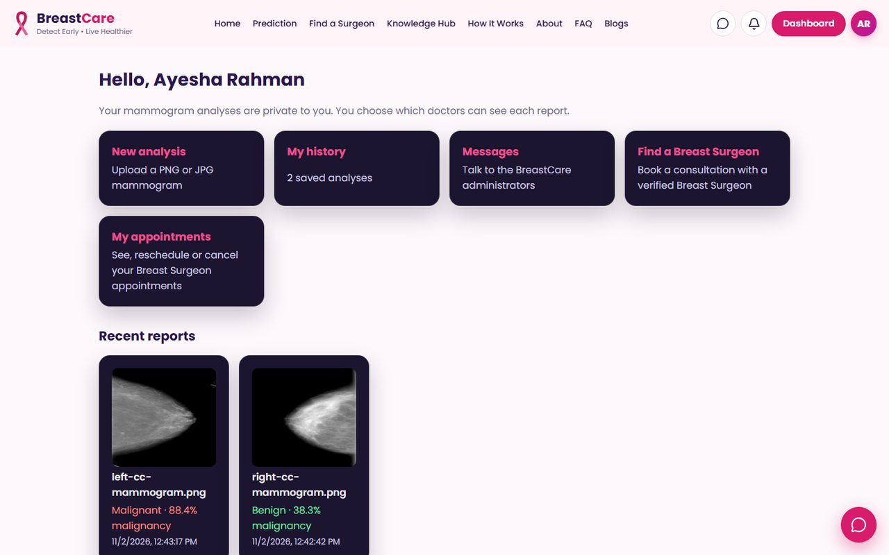 |
| **Knowledge Hub** | **On a phone** |
| 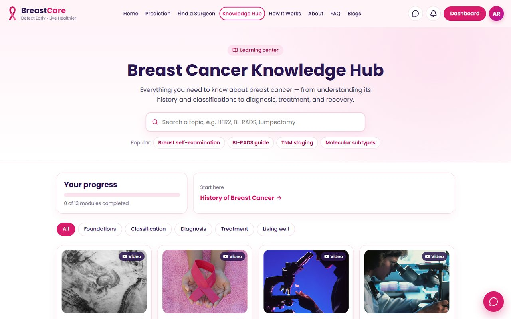 | 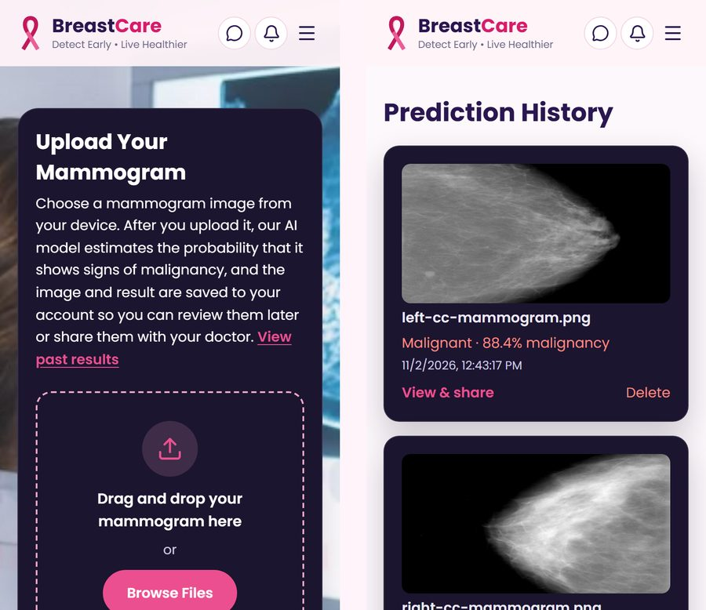 |

## 🧭 How It Works

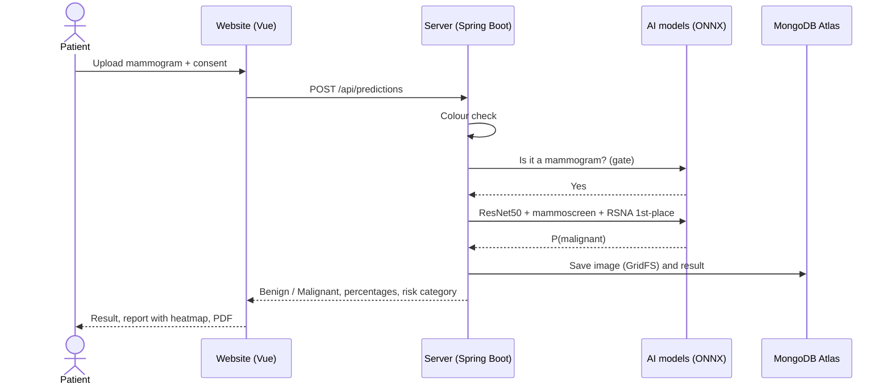

1. **Sign up** as a patient (or as a doctor) and log in.
2. **Upload** a mammogram (PNG or JPEG, CC or MLO view, up to 50 MB) on the Prediction page and accept the privacy notice.
3. The server **checks the image**: colour photos and anything that is not a mammogram are refused with a clear message.
4. The **AI models** estimate the probability of malignancy (about 6 seconds on a laptop CPU).
5. You see **Benign** or **Malignant**, both percentages, a risk category and a reminder that this is not a diagnosis.
6. The **report** opens with the image, a zoomable heatmap and a downloadable PDF.
7. **Share** the report with a doctor, and ask a doctor you have a confirmed appointment with for a written review.
8. Everything stays in your **history** until you delete it, which also deletes the image.

## ✨ Features

- **Mammogram analysis:** Benign/Malignant with probabilities, a risk category and a heatmap viewer.
- **Downloadable PDF report** for every scan.
- **Role-based accounts:** Patient, Doctor and Admin.
- **Doctor care flow:** patients share reports and request reviews; doctors write reviews and can run detection for their patients.
- **Find a Breast Surgeon:** verified surgeon profiles, availability calendar and appointment booking.
- **Admin console:** user management, doctor verification, site overview, inbox, audit logs and encrypted backups.
- **Knowledge Hub:** 13 learning modules on breast cancer (including self-examination, BI-RADS and breast implants),
  with videos, a glossary and FAQ.
- **Chatbot:** BreastCare Assistant answers breast-health questions only (from the Knowledge Hub by default, optional Google Gemini).
- **Blogs:** breast cancer news and research articles from trusted sources.
- **Responsive design:** works on phones, tablets and desktops.

## 🛠 Tech Stack

| Part | Technology |
|---|---|
| Frontend | Vue 3, Vite |
| Backend | Spring Boot 4, Java 21, Spring Security (JWT in HttpOnly cookie) |
| Database | MongoDB Atlas (GridFS for images) |
| ML inference | ONNX Runtime (CPU), inside the Spring Boot backend |
| ML training | Python, PyTorch (Kaggle), used only to train and export models |
| Deployment | Vercel, Render, Docker, Kubernetes, GitHub Actions |

## 🏗 Architecture

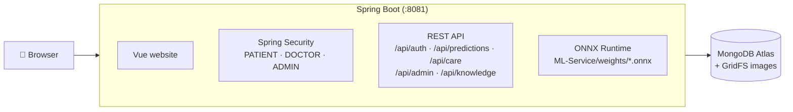

Deployed version:

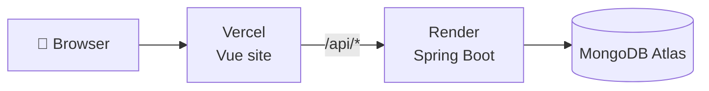

Vercel forwards `/api` to Render, so the browser talks to one domain and the login cookie stays first-party.

The project follows MVC: **View** (`Frontend/src/views`), **Controller** (`Backend/.../controller`), **Model** (`Backend/.../model`, `repository`), plus Service and Security layers.

## 👥 Roles

| Role | Created by | Can |
|---|---|---|
| **Patient** | Sign up at `/register` | Upload mammograms; view, delete and share own reports; book appointments; request reviews |
| **Doctor** | Sign up at `/register` as a doctor; the Breast Surgeon profile is listed after an admin approves it | See reports shared with them, write reviews, manage appointments and availability |
| **Admin** | `ADMIN_EMAIL` / `ADMIN_PASSWORD` on first start | Manage users and the site, verify doctors; cannot read individual medical records |

## 🤖 The Model

The server runs a chain of checks and models on CPU:

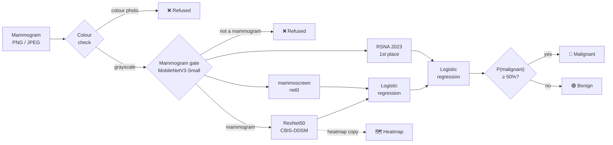

1. **Colour check:** colour photos are refused (mammograms are grayscale).
2. **Mammogram gate** (MobileNetV3-Small, trained for this project): refuses anything that is not a mammogram.
3. **Cancer estimate**, an ensemble of:
   - a **ResNet50** fine-tuned on CBIS-DDSM for this project,
   - **mammoscreen net0** ([ianpan/mammoscreen](https://huggingface.co/ianpan/mammoscreen), Apache-2.0),
   - the **RSNA 2023 1st-place** ConvNeXt-Small model (fold 0).
   Their probabilities are combined with logistic regression.
4. **Result:** *Malignant* if the final estimate is 50% or more, otherwise *Benign*.
5. **Heatmap:** a class activation map from the ResNet50, drawn on the report page.

Training labels: 0 = benign, 1 = malignant. Results on **INbreast** patients not used for fitting (367 images, BI-RADS 5-6 vs 1-3):

| Metric | Value |
|---|---|
| ROC-AUC | 0.948 |
| Accuracy | 93.7% |
| Sensitivity (recall) | 68.4% |
| Specificity | 98.4% |
| Precision | 88.6% |

INbreast is small, so the confidence intervals are wide. The model still **misses some cancers** (about 1 in 3 in
this test) and raises false alarms. The website shows these numbers, with intervals, under every result.

> [!NOTE]
> Model files are git-ignored (about 460 MB) and must be copied to the server. Training and export scripts are in `ML-Service/`.

## 📁 Project Structure

```text
Cancer_web/
├─ Frontend/          Vue 3 + Vite website (views, components, router, tests)
├─ Backend/           Spring Boot API, security, ONNX inference, MongoDB
│  ├─ docs/           Docker, Kubernetes, CI/CD, blockchain, audit/backup guides
│  └─ k8s/            Kubernetes manifests
├─ ML-Service/        Python training, evaluation and ONNX export (not deployed)
├─ docs/screenshots/  Images used in this README
├─ render.yaml        Render deployment
├─ DEPLOYMENT.md      Step-by-step deployment guide
└─ live-demo.cmd      Full app with AI from a laptop through a free public link
```

## 🚀 Getting Started

### Requirements

- Java 21 (use the bundled `mvnw` / `mvnw.cmd`)
- Node.js 20+
- Python 3.10+ (only to train or export models)
- A MongoDB Atlas cluster (free M0 is enough)

### 1. Configure the backend

Copy `Backend/.env.example` to `Backend/.env` and set:

<details>
<summary><b>Environment variables</b> (click to expand)</summary>

| Variable | Required | Purpose |
|---|---|---|
| `MONGODB_URI` | yes | Atlas connection string including database name `breast_cancer` |
| `JWT_SECRET` | yes | 48+ random characters, signs login tokens |
| `ADMIN_EMAIL`, `ADMIN_PASSWORD` | first run | Creates the first administrator |
| `AUTH_COOKIE_SECURE` | production | Set `true` on HTTPS |
| `CORS_ORIGINS` | optional | Allowed frontend origins |
| `GEMINI_API_KEY` | optional | Enables Gemini answers in the chatbot |

</details>

### 2. Run (single server)

```powershell
cd Frontend
npm install
npm run build

cd ..\Backend
.\mvnw.cmd spring-boot:run
```

Open **http://localhost:8081**.

### Development with hot reload

Run the backend as above, then in `Frontend` run `npm run dev` and open http://localhost:5173.

## 🔒 Security and Privacy

- Passwords hashed with BCrypt; login via JWT in an `HttpOnly`, `SameSite=Strict` cookie.
- CSRF protection on all POST/PATCH/DELETE requests.
- Logout revokes the token immediately.
- Every record lookup is filtered by owner or share list.
- Images are stored privately in MongoDB (GridFS), never sent to an outside AI service.
- Append-only, hash-chained audit log with encrypted backups; no patient data on the blockchain.

> [!CAUTION]
> Known limits: no login rate limiting, password reset or email verification yet.

## ⚠️ Limitations

> [!IMPORTANT]
> Not a medical device and not clinically validated. Every result must be reviewed by a qualified doctor.

- Not a substitute for screening by a radiologist.
- Tested on public research datasets; images from other hospitals or machines can give different results.
- Works on single 2D mammogram views; it does not combine views, compare with earlier scans or use patient history.
- The free live server sleeps after 15 minutes without visitors, so the first request can take about a minute.

## 🧪 Tests

<details>
<summary><b>Run the test suites</b></summary>

```powershell
cd Backend
.\mvnw.cmd test

cd ..\Frontend
npm test
```

</details>

## 📦 Deployment

| Part | Where | Notes |
|---|---|---|
| Frontend | Vercel | Auto-deploys from `main` (root directory `Frontend`) |
| Backend | Render (free) | Docker, from `render.yaml`; runs without the AI models |
| Database | MongoDB Atlas (M0) | |
| Full demo with AI | `live-demo.cmd` | Runs on a laptop and opens a free public https link |

See [DEPLOYMENT.md](DEPLOYMENT.md) for every step, and `Backend/docs/` for Docker, Kubernetes, CI/CD, blockchain and audit/backup/privacy setup.

## 🙏 Acknowledgements

- **CBIS-DDSM:** Sawyer-Lee, R., Gimenez, F., Hoogi, A., & Rubin, D. (2016). *Curated Breast Imaging Subset of DDSM.*
  The Cancer Imaging Archive (CC BY 3.0). Used for training, testing and the screenshots in this README.
- **INbreast** for testing, **VinDr-Mammo** for fitting the ensemble.
- **ianpan/mammoscreen** and **ianpan/mammo-crop** (Apache-2.0), the **RSNA 2023 Screening Mammography** 1st-place
  solution (dangnh0611), and the ResNet50 mammography checkpoint from **umairinayat/medical-models** (MIT).
- Photos from Unsplash (see `Frontend/src/assets/*/CREDITS.md`).
